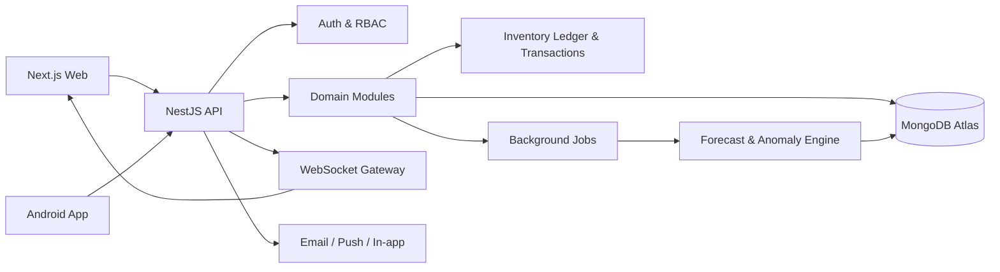
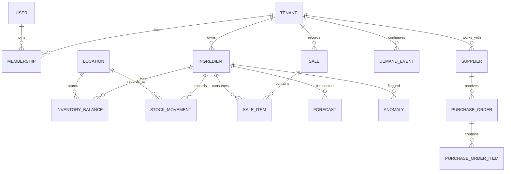
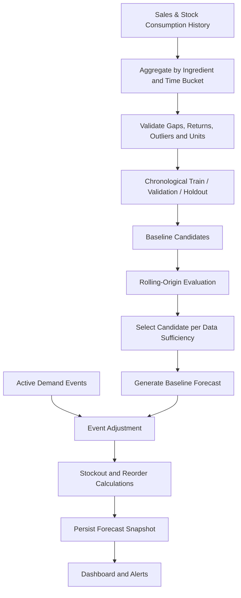

# PotionPulse — Product Requirements Document

**Product:** PotionPulse  
**Hackathon:** MSOT Halloween Night Hackathon 2026  
**Track:** Track 01 — The Witch's Potion Pantry  
**Category:** AI + Full Stack + Web + Android  
**Document version:** 1.0  
**Status:** Implementation-ready baseline  
**Primary implementation environment:** Google Antigravity  
**Target platforms:** Web dashboard and Android application  
**Audience:** Product team, 2–3 student developers, Antigravity coding agents, evaluators

> **Source hierarchy:** The official MSOT Track 01 problem statement defines mandatory competition requirements and judging criteria. The product decisions in this PRD extend that baseline according to the discovery answers supplied by the project owner. Where the official brief is silent, this document marks a practical implementation decision or assumption rather than presenting it as an organizer requirement.

---

## 1. Document Overview

### 1.1 Product summary
PotionPulse is a multi-tenant inventory intelligence SaaS platform for potion shops and other small inventory-led businesses. It combines reliable stock operations with explainable demand forecasting, stockout risk prediction, anomaly detection, event-aware demand planning, procurement guidance, and synchronized web and Android experiences.

### 1.2 Product identity
- **Name:** PotionPulse
- **Tagline:** Predict. Manage. Thrive.
- **Positioning:** Inventory intelligence that helps businesses anticipate shortages instead of reacting to them.
- **Brand personality:** Professional, confident, intelligent, atmospheric, and lightly magical. Avoid childish Halloween imagery.
- **Visual direction:** Premium SaaS interface with a refined Halloween identity: deep plum/purple, warm orange accents, near-black surfaces where appropriate, subtle potion/glass motifs, restrained glow, clear data visualization, and accessible contrast.

### 1.3 Glossary
| Term | Meaning |
|---|---|
| Tenant | An independent shop/business workspace. |
| Ingredient | A stock-controlled raw material or sellable inventory item. |
| Stock movement | An immutable record of stock entering, leaving, or being adjusted. |
| On-hand | Current physically recorded quantity. |
| Available | On-hand minus reserved quantity, plus eligible incoming stock only where the calculation explicitly requires it. |
| Lead time | Expected time between placing an order and receiving stock. |
| Safety stock | Buffer quantity intended to reduce stockout risk. |
| Forecast horizon | Future period for which demand is estimated. |
| Midnight Curse | The official scenario in which demand for three ingredients triples during a full-moon festival period next week. |
| Idempotency key | Client-provided unique key that prevents the same write operation being applied twice. |

### 1.4 Revision history
| Version | Date | Notes |
|---|---|---|
| 1.0 | 2026-10-31 | Initial implementation baseline based on discovery and official Track 01 brief. |

## 2. Executive Summary

PotionPulse addresses the central problem in The Witch's Potion Pantry: a shop may have stock recorded today but still run out tomorrow because demand is uncertain, consumption is not consistently tracked, and seasonal events can sharply change demand. The official challenge requires stock tracking, ingredient create/update/sale recording, predictions of what will run out and when, reorder quantities, unusual-consumption detection, demand charts, and working web and Android apps connected to one backend.

PotionPulse delivers these capabilities through a shared NestJS backend and MongoDB data layer. A Next.js + TypeScript + Tailwind web application provides the primary management dashboard. The Android client uses a native-capable cross-platform approach selected for delivery speed and API compatibility (React Native with Expo is the default recommendation; use a native Android implementation only if the team has a concrete reason and can sustain it). Forecasting is a separate Python service or isolated backend module, depending on deployment constraints, and uses statistical/time-series methods rather than an LLM to calculate numeric predictions.

The product is designed as a commercial-style multi-tenant SaaS, but the hackathon build must prioritize a complete, demonstrable vertical slice over breadth. Advanced modules such as CRM, loyalty, billing, broad integrations, and cross-shop benchmarking must not compromise the mandatory inventory/forecast/anomaly/web/Android requirements. All features are free in the initial release; no subscription payment flow is required.

## 3. Problem Statement & Objectives

### 3.1 Official challenge statement
Madam Hexley runs a busy potion shop and repeatedly runs out of important ingredients such as bat wings, mandrake root, and ghost pepper. The solution must track stock across shelves, add and update ingredients, record sold items, predict which ingredients will run out and when, recommend reorder quantities, flag unusual consumption such as sudden spikes or missing stock, show demand charts over time, and provide both a web dashboard and an Android app connected to the same backend.

### 3.2 Official evaluation criteria
1. Prediction accuracy on hidden future sales data.
2. Number and quality of anomalies detected.
3. Working web and Android applications.
4. Overall user experience.

### 3.3 Official Midnight Curse
A full-moon festival is announced for the following week and demand for three ingredients will triple. PotionPulse must account for the sudden seasonal spike. The multiplier must affect the relevant ingredients and future event dates only; it must not rewrite historical sales.

### 3.4 Product objectives
- Maintain an accurate, auditable inventory ledger.
- Reduce avoidable stockouts by forecasting demand and calculating risk.
- Provide useful reorder recommendations with clear assumptions.
- Detect unusual consumption and unexplained stock discrepancies.
- Make event-driven demand changes visible and actionable.
- Keep web and Android consistent through a centralized backend.
- Present the solution clearly enough for judges to verify each scoring dimension.

### 3.5 Success criteria
No accuracy percentage is guaranteed in advance. The system must report measured results from a reproducible chronological holdout evaluation. Release gates:
- All mandatory CRUD and stock movement flows pass integration tests.
- The same tenant's web and Android clients observe the same server-side inventory state.
- Forecasts include horizon, generated-at timestamp, model/baseline identifier, and evaluation metrics when available.
- Stockout date and reorder quantity can be recomputed from stored inputs.
- Synthetic anomaly cases are detected with documented expected outcomes; false positives are reviewed.
- Midnight Curse scenario applies a 3× multiplier to exactly three configured ingredients during the event interval and expires cleanly.
- No critical tenant-isolation or authorization test fails.
- Both clients can complete the core demonstration flow.

## 4. Product Scope

### 4.1 Mandatory MVP — must ship first
- Authentication and tenant/workspace setup.
- Ingredient catalog and stock-by-location/shelf tracking.
- Add, edit, archive and view ingredients.
- Record sales/consumption and stock adjustments.
- Immutable stock movement ledger.
- Historical demand charts.
- Demand forecasts and stockout estimates.
- Reorder recommendations.
- Anomaly detection for demand spikes and stock discrepancies.
- Midnight Curse event configuration and 3× demand adjustment.
- Web dashboard.
- Android application connected to the same API and database.
- Shared backend, authorization, validation, auditability, and tests.

### 4.2 Included extended product capabilities
Implement after the mandatory vertical slice is stable:
- Supplier directory and lead-time history.
- Purchase orders and receiving.
- Recipe/potion formulation with ingredient consumption rules.
- Batch, expiry, wastage and production planning.
- Customer and order records, refunds and basic sales insights.
- CSV import/export with validation and error report.
- In-app, email and Android push notifications.
- Real-time web updates via WebSocket; Android refresh/push strategy must use the same server state.
- Role-based access control.
- Shop-specific currency, timezone, date and measurement preferences.
- Reports, audit export, backup/recovery operations.

### 4.3 Future enhancements (not allowed to block MVP)
- Paid subscription billing (explicitly excluded from initial release).
- Advanced supplier marketplace integrations.
- Automated external purchasing.
- Deep learning models requiring large datasets.
- Cross-tenant benchmarking or data pooling.
- Offline-first inventory mutation. Initial application is online-only.
- Full ERP/accounting integrations.

### 4.4 Scope conflict rule
When schedule or integration risk appears, prioritize in this order: (1) backend and inventory integrity, (2) web + Android shared-backend proof, (3) forecasting/stockout/reorder, (4) anomaly detection, (5) Midnight Curse, (6) analytics and polish, (7) extended business modules. Never sacrifice mandatory criteria to complete optional SaaS breadth.

## 5. User Personas & Permissions

### 5.1 Roles
| Role | Capabilities |
|---|---|
| Platform super-admin | Platform-level tenant/user administration, system health and support access with audited elevation. No routine access to tenant business data. |
| Shop owner | Full access to their tenant, users, settings, inventory, sales, forecasts, suppliers, reports and audit history. |
| Shop manager | Manage daily operations, inventory, sales, suppliers, forecasts and team members within granted scope. |
| Inventory staff | View and update assigned stock, record movements, receive purchase orders where permitted. Cannot manage tenant billing/settings or roles. |
| Read-only analyst | View dashboards, forecasts and reports; cannot mutate business data. |

### 5.2 Authorization rules
- Every tenant-owned record carries `tenantId`.
- The authenticated user's active tenant membership is resolved server-side.
- Never trust a tenant ID supplied only in the request body or query string.
- All repository queries must be tenant-scoped by default.
- Platform super-admin access must use a separate explicit permission and create an audit event.
- Deny by default; verify role permission at controller/service boundary.

### 5.3 Authentication
Support email/password and Google authentication. Use a managed OAuth/OIDC-compatible provider or a well-maintained authentication library. Passwords must be hashed with Argon2id or bcrypt using secure parameters. Do not store plaintext passwords or expose provider secrets to clients.

## 6. Functional Requirements

Each requirement uses an ID for traceability. P0 = mandatory/critical, P1 = important extension, P2 = later enhancement.

### 6.1 Authentication, onboarding and tenant management
**FR-AUTH-01 (P0):** A user can register/sign in with email or Google.  
**FR-AUTH-02 (P0):** First-time owner can create a shop workspace with name, timezone, currency and default unit system.  
**FR-AUTH-03 (P0):** Invite/add team members and assign roles.  
**FR-AUTH-04 (P1):** Guided onboarding offers sample inventory, CSV import and short product tour.  
**Rules:** A user can belong to multiple tenants, but each request operates within one validated active membership. Tenant switching must refresh authorization context.

### 6.2 Ingredient catalog
**FR-ING-01 (P0):** Create, view, update and archive ingredients.  
**FR-ING-02 (P0):** Store name, SKU/code, category, unit, reorder threshold, safety stock, preferred supplier, lead time, cost, storage location and active status.  
**FR-ING-03 (P1):** Support ingredient aliases and normalized units.  
**FR-ING-04 (P1):** Track batch/lot and expiry information.  
**Validation:** Name required; unit required; quantities non-negative; SKU unique within tenant when provided; unit conversions explicit and deterministic. Archived items remain in historical sales and movements.

### 6.3 Inventory and stock movements
**FR-INV-01 (P0):** Display on-hand quantity by ingredient and shelf/location.  
**FR-INV-02 (P0):** Record receipts, sales/consumption, wastage, returns, transfers and manual adjustments as immutable movements.  
**FR-INV-03 (P0):** Update current balance atomically with movement creation.  
**FR-INV-04 (P0):** Reject invalid negative stock unless a tenant-level backorder/negative-stock policy is explicitly enabled; default is reject.  
**FR-INV-05 (P0):** Require a reason for manual adjustments and record actor/time/source.  
**FR-INV-06 (P1):** Support batch/expiry-aware stock rotation (FEFO where expiry applies).  
**FR-INV-07 (P1):** Support bulk stock import with preview and row-level errors.

**Stock movement types:** `RECEIPT`, `SALE`, `CONSUMPTION`, `WASTAGE`, `RETURN`, `TRANSFER_IN`, `TRANSFER_OUT`, `ADJUSTMENT_IN`, `ADJUSTMENT_OUT`, `REVERSAL`.

**Consistency rule:** A movement is never edited in place after posting. Correct mistakes with a compensating reversal/adjustment. A transaction must atomically write the movement, update balance, and record idempotency key.

### 6.4 Sales and order recording
**FR-SALE-01 (P0):** Record a sale with one or more line items and quantities.  
**FR-SALE-02 (P0):** Reduce inventory through stock movements in the same transaction.  
**FR-SALE-03 (P1):** Support recipe-driven ingredient deduction when a potion/product is sold.  
**FR-SALE-04 (P1):** Record refunds as explicit refund events and compensating stock movements only when returned goods are actually restocked.  
**FR-SALE-05 (P1):** Provide daily/weekly/monthly sales and consumption summaries.

### 6.5 Recipes and production
**FR-REC-01 (P1):** Define potion/product recipes with ingredient quantities and units.  
**FR-REC-02 (P1):** Version recipes; historical orders retain the recipe version used at sale time.  
**FR-REC-03 (P1):** Scale recipes for batch size and calculate ingredient requirements, estimated cost, expected yield and wastage.  
**FR-REC-04 (P1):** Validate stock availability before production; production completion posts consumption movements.

### 6.6 Supplier and procurement management
**FR-SUP-01 (P1):** Maintain supplier profile, contact, catalog, lead time, minimum order quantity and reliability notes.  
**FR-PO-01 (P1):** Create purchase orders from manual or recommended quantities.  
**FR-PO-02 (P1):** Track draft, submitted, partially received, received and cancelled states.  
**FR-PO-03 (P1):** Receiving a purchase order posts receipt movements and updates incoming quantities.  
**FR-SUP-02 (P1):** Store price and delivery history for supplier comparison.

### 6.7 Demand forecasting
**FR-FC-01 (P0):** Generate per-ingredient forecasts using historical sales/consumption and known future events.  
**FR-FC-02 (P0):** Display historical actuals and forecast values on a common timeline.  
**FR-FC-03 (P0):** Show forecast horizon, generated timestamp, model/baseline, confidence or uncertainty range when statistically supportable, and data sufficiency indicator.  
**FR-FC-04 (P0):** Select horizon/granularity adaptively: daily for near-term operational planning when adequate observations exist; otherwise use weekly or a clearly labelled fallback.  
**FR-FC-05 (P0):** Never train on future holdout values or use random splits for time-series validation.  
**FR-FC-06 (P1):** Compare forecast versus actual after actuals arrive and retain evaluation history.

**Forecasting strategy:** Start with robust baselines: seasonal-naive where seasonality is observable, moving average, and exponentially weighted/smoothing methods. Evaluate candidates with rolling-origin/chronological validation. Only add regression/gradient-boosted models if data volume and feature availability justify them. Do not default to deep learning. Use a simple model per ingredient or a pooled model only when justified by the data. A deterministic fallback must always exist.

### 6.8 Stockout risk and restock recommendations
**FR-STK-01 (P0):** Estimate days until stockout and expected stockout date using projected consumption and available stock.  
**FR-STK-02 (P0):** Assign a transparent risk level (e.g. critical/high/medium/low) using days of cover, lead time and safety stock.  
**FR-STK-03 (P0):** Recommend reorder quantity based on forecast demand over lead time plus target coverage and safety stock, minus usable on-hand and incoming quantities.  
**FR-STK-04 (P0):** Explain inputs and assumptions used in each recommendation.  
**FR-STK-05 (P1):** Respect supplier minimum order quantity, pack size and expiry constraints.

**Core formulas:**
- `projected_available(t) = onHand + confirmedIncomingBy(t) - reserved - cumulativeForecastDemandThrough(t)`.
- `daysOfCover = onHand / max(meanDailyDemand, epsilon)`; if demand is zero/insufficient, return `UNKNOWN` rather than infinity as a date.
- `expectedStockoutDate` is the first future date where cumulative forecast demand exceeds usable stock plus confirmed incoming stock.
- `leadTimeDemand = sum(forecastDailyDemand over supplierLeadTimeDays)`.
- `targetCoverageDemand = sum(forecastDailyDemand over targetCoverageDays)`.
- `rawReorderQty = max(0, leadTimeDemand + safetyStock + targetCoverageDemand - onHand - confirmedIncoming)`.
- Apply pack size/MOQ rounding only after raw quantity calculation: `recommendedQty = ceil(max(rawReorderQty, MOQ) / packSize) * packSize` when raw quantity is positive.

The interface must show the unrounded calculation, applied MOQ/pack size, and final recommendation. Do not double-count lead-time demand inside target coverage; define target coverage as post-lead-time coverage or use one explicitly documented combined coverage window.

### 6.9 Anomaly detection
**FR-AN-01 (P0):** Detect unusual consumption spikes by comparing observed consumption with a historical baseline appropriate to the data volume.  
**FR-AN-02 (P0):** Detect unexplained stock changes by reconciling ledger-derived balance with counted/recorded balance.  
**FR-AN-03 (P0):** Flag duplicate, unusually large, or out-of-pattern adjustments for review.  
**FR-AN-04 (P0):** Store anomaly type, severity, affected ingredient, observed value, baseline, deviation, timestamp, explanation and status.  
**FR-AN-05 (P1):** Allow authorized users to acknowledge, resolve or mark false positive with a reason.

**Initial approach:** Use robust statistical methods first: rolling median/MAD or robust z-score for consumption, minimum-volume safeguards, and ledger reconciliation for discrepancies. A simple seasonal baseline may be used when enough history exists. Thresholds are configurable and calibrated on sample data. Avoid claiming an anomaly is fraud; describe it as an unusual event requiring review. Track precision/recall on labelled synthetic scenarios and manually review false positives.

### 6.10 Midnight Curse event intelligence
**FR-EVT-01 (P0):** Create an event with name, start/end timestamps, affected ingredient IDs, multiplier and description.  
**FR-EVT-02 (P0):** Configure exactly three affected ingredients for the official demo scenario, with multiplier 3.0.  
**FR-EVT-03 (P0):** Apply multiplier only to forecast dates within event interval and affected ingredients.  
**FR-EVT-04 (P0):** Recalculate stockout and reorder outputs when event changes.  
**FR-EVT-05 (P0):** Display event impact separately from baseline forecast.  
**FR-EVT-06 (P0):** Expire event influence after end time without modifying historical sales.  
**FR-EVT-07 (P1):** Support other events and multipliers after the official scenario is validated.

**Formula:** `eventAdjustedDemand(i,t) = baselineForecast(i,t) * productOf(activeEventMultipliersFor(i,t))`. Prevent accidental duplicate application by storing event IDs in forecast metadata and computing adjusted demand from baseline, not from a previously adjusted forecast. Overlapping events require an explicit tenant policy; default combine multiplicatively but cap only if a documented business setting exists.

### 6.11 Analytics and reporting
**FR-ANL-01 (P0):** Show demand history and forecast charts per ingredient.  
**FR-ANL-02 (P0):** Dashboard cards show low-stock items, stockout risks, open anomalies, forecast demand and reorder suggestions.  
**FR-ANL-03 (P1):** Reports for stock movement, consumption, wastage, supplier performance, forecast accuracy and purchase history.  
**FR-ANL-04 (P1):** Export CSV/XLSX or PDF reports where feasible; CSV is the minimum reliable export.

### 6.12 Notifications
**FR-NOT-01 (P0):** In-app alerts for critical stockout risk, anomalies and purchase receipts.  
**FR-NOT-02 (P1):** Email alerts and Android push notifications.  
**FR-NOT-03 (P1):** User-configurable notification preferences and severity thresholds.  
**FR-NOT-04 (P1):** Deduplicate repeated alerts using a stable alert fingerprint and cooldown window.

### 6.13 Import/export and data management
**FR-DATA-01 (P1):** CSV import preview, field mapping, validation, duplicate detection and downloadable row-error report.  
**FR-DATA-02 (P1):** Export ingredients, movements, sales, forecasts and reports within the user's tenant scope.  
**FR-DATA-03 (P1):** Record import history, actor, timestamp, counts and outcome.

### 6.14 Real-time synchronization
**FR-SYNC-01 (P0):** All mutations are committed to the centralized backend; clients never calculate authoritative stock independently.  
**FR-SYNC-02 (P1):** WebSocket events notify connected clients of committed changes.  
**FR-SYNC-03 (P0):** Android refreshes or receives push updates and re-fetches canonical server state.  
**FR-SYNC-04 (P0):** Use optimistic concurrency/version fields to prevent silent lost updates.

## 7. Web Frontend Architecture

### 7.1 Stack
- Next.js (App Router) + TypeScript.
- Tailwind CSS.
- Component primitives with accessible keyboard/focus behavior (e.g. shadcn/ui or equivalent; declare dependencies).
- TanStack Query or equivalent for server state; lightweight local state for UI-only state.
- Zod or equivalent for client form schemas, with server validation remaining authoritative.
- Recharts or another maintained chart library.

### 7.2 Navigation
Primary navigation: Overview, Inventory, Sales & Orders, Forecasts, Anomalies, Procurement, Recipes, Analytics, Notifications, Team & Settings. Hide or mark optional modules until enabled; keep core tasks prominent.

### 7.3 Screen specifications
| Screen | Purpose and required behavior |
|---|---|
| Sign in / Register | Email and Google sign-in, validation, loading/error states, password reset. |
| Onboarding wizard | Create shop, choose timezone/currency/units, add sample data or import, invite team. |
| Overview dashboard | KPIs, low-stock list, stockout risk, anomaly queue, forecast snapshot, event banner. |
| Inventory list | Search/filter/sort, quantity by location, low-stock indicator, add/edit/archive, bulk actions. |
| Ingredient detail | Stock ledger, batches, supplier, consumption history, forecast chart, reorder explanation. |
| Record sale | Line items, quantities, recipe deduction preview, validation, confirmation. |
| Stock movement | Receive/adjust/transfer/waste/return with reason, actor and confirmation. |
| Forecast center | Actual vs predicted chart, horizon selector, confidence/data sufficiency, model metadata. |
| Stockout & reorder | Risk-ranked list, expected stockout date, reorder calculation breakdown, create PO. |
| Anomaly center | Severity filters, explanation, acknowledge/resolve workflow and audit trail. |
| Midnight Curse/events | Event creation, three affected ingredients, date range, 3× multiplier, impact preview. |
| Suppliers & purchase orders | Supplier list/detail, PO creation, status, partial/full receipt. |
| Recipes & production | Recipe editor, scaling, stock availability, production completion. |
| Analytics & reports | Consumption, wastage, forecast accuracy, supplier metrics, export. |
| Team & settings | Memberships, roles, regional settings, notification preferences, audit access. |

Every data screen must implement loading, empty, error, permission-denied and success states. Forms must prevent accidental double-submit and display field-level errors. Charts require text summaries or accessible data tables for key values.

### 7.4 Design system
Use a professional, high-contrast palette. Suggested tokens (verify contrast before implementation):
| Token | HEX | Usage |
|---|---|---|
| Ink | `#171321` | Primary text / dark surfaces |
| Midnight Plum | `#241638` | Brand dark |
| Potion Purple | `#7046C8` | Primary actions |
| Violet Glow | `#A78BFA` | Secondary highlight |
| Ember Orange | `#F28C28` | Important event / warning accent |
| Pale Lavender | `#F4F0FA` | Light page background |
| Cloud White | `#FFFFFF` | Cards / surfaces |
| Success Green | `#23865B` | Positive state |
| Warning Amber | `#B96B12` | Warning state |
| Danger Red | `#C23D4B` | Critical state |
| Muted Text | `#6B6575` | Secondary text (verify contrast) |

Typography: use a clean sans-serif such as Inter. Use a consistent 4/8px spacing scale, restrained shadows, 12–18px card radii, clear chart labels and predictable table density. Avoid excessive glow, animated particles, or decorative graphics that impair data scanning. Respect reduced-motion settings.

### 7.5 Responsive behavior
Desktop-first dashboard with responsive tablet/mobile layouts. On narrow screens, convert dense tables to stacked cards or horizontally scrollable data grids with clear labels. Core inventory and sales actions must remain usable on mobile web.

## 8. Android Application Architecture

### 8.1 Technology decision
Default recommendation: React Native + Expo + TypeScript for shared development skills and rapid API integration. The user selected “Let AI Decide” for Android technology; this is an implementation recommendation, not a user-fixed requirement. If the team already has native Android expertise, Kotlin + Jetpack Compose is an acceptable alternative, but do not maintain two competing Android implementations.

### 8.2 Required screens
- Sign in / tenant selection.
- Home summary.
- Inventory list and ingredient detail.
- Add/edit ingredient.
- Record sale/consumption.
- Receive/adjust stock.
- Forecast summary and stockout risks.
- Anomaly alerts.
- Notifications.
- Settings/profile.

### 8.3 Online-only behavior
The application requires internet for all inventory mutations. If offline, clearly disable write actions and show a connection banner. Read-only cached summaries may be displayed if their stale timestamp is visible, but no queued offline mutation may be silently submitted later.

### 8.4 Android quality
Use secure token storage, deep-link-safe authentication, accessible touch targets, system back navigation, push notification permission handling and explicit API error states. Android and web must use the same backend business rules.

## 9. Backend Architecture

### 9.1 Stack and architecture
- Node.js + NestJS + TypeScript.
- Modular monolith for hackathon delivery; do not begin with microservices.
- MongoDB Atlas.
- REST API with OpenAPI/Swagger documentation.
- WebSocket gateway for optional live updates.
- Background job queue for forecast generation, imports and notifications; use a simple queue only if operationally supportable. Otherwise use scheduled jobs with durable status records.
- Python forecasting worker/service only if it materially improves model tooling; otherwise implement baseline/statistical methods in a dedicated TypeScript module. Keep the forecast contract independent of language.

### 9.2 Modules
`AuthModule`, `TenantsModule`, `UsersModule`, `IngredientsModule`, `InventoryModule`, `MovementsModule`, `SalesModule`, `RecipesModule`, `SuppliersModule`, `PurchaseOrdersModule`, `ForecastsModule`, `StockoutModule`, `RestockModule`, `AnomaliesModule`, `EventsModule`, `AnalyticsModule`, `NotificationsModule`, `ImportsExportsModule`, `AuditModule`, `HealthModule`.

### 9.3 Architecture diagram


### 9.4 Backend principles
- Backend is the source of truth for inventory and business calculations.
- Validate every DTO at the API boundary and revalidate business invariants in services.
- Keep controllers thin; put domain rules in services.
- Tenant-scoped repository methods must be the default.
- All mutating endpoints support idempotency where duplicate submission is harmful.
- Store timestamps in UTC; render in tenant timezone.
- Use structured logs with request ID, tenant ID, actor ID and operation type; never log secrets or sensitive payloads.

## 10. API Specification

**Base path:** `/api/v1`  
**Authentication:** Bearer access token.  
**Conventions:** JSON, ISO-8601 timestamps, pagination via `page`/`limit` or cursor, consistent error envelope. All tenant-owned routes derive tenant from authenticated membership context.

### 10.1 Standard error format
```json
{
  "error": {
    "code": "VALIDATION_ERROR",
    "message": "The request contains invalid fields.",
    "details": [{"field": "quantity", "message": "Must be greater than zero."}],
    "requestId": "req_..."
  }
}
```

### 10.2 Endpoint inventory
| Method | Endpoint | Purpose | Permission |
|---|---|---|---|
| POST | `/auth/register` | Register with email | Public |
| POST | `/auth/login` | Email login | Public |
| POST | `/auth/google` | Google sign-in exchange | Public |
| POST | `/auth/refresh` | Refresh session | Authenticated |
| POST | `/auth/logout` | Revoke session | Authenticated |
| GET | `/me` | Current user and memberships | Authenticated |
| POST | `/tenants` | Create shop | Authenticated |
| GET | `/tenants/current` | Active tenant profile | Tenant member |
| PATCH | `/tenants/current` | Update tenant settings | Owner/manager |
| GET | `/members` | List tenant members | Owner/manager |
| POST | `/members/invitations` | Invite member | Owner/manager |
| PATCH | `/members/:id/role` | Change role | Owner |
| GET | `/ingredients` | List ingredients | Tenant member |
| POST | `/ingredients` | Create ingredient | Owner/manager/inventory |
| GET | `/ingredients/:id` | Ingredient detail | Tenant member |
| PATCH | `/ingredients/:id` | Update ingredient | Owner/manager/inventory |
| DELETE | `/ingredients/:id` | Archive ingredient | Owner/manager |
| GET | `/inventory/balances` | Current balances by location | Tenant member |
| POST | `/inventory/movements` | Post stock movement | Owner/manager/inventory |
| GET | `/inventory/movements` | Movement history | Tenant member |
| POST | `/sales` | Record sale and deductions | Owner/manager/inventory |
| GET | `/sales` | List sales | Tenant member |
| GET | `/sales/:id` | Sale detail | Tenant member |
| POST | `/sales/:id/refunds` | Record refund | Owner/manager |
| GET | `/forecasts` | Retrieve latest forecasts | Tenant member |
| POST | `/forecasts/run` | Trigger forecast generation | Owner/manager |
| GET | `/forecasts/:ingredientId` | Ingredient forecast series | Tenant member |
| GET | `/stockout/risks` | Stockout risk list | Tenant member |
| GET | `/restock/recommendations` | Reorder recommendations | Tenant member |
| GET | `/anomalies` | List anomaly events | Tenant member |
| PATCH | `/anomalies/:id` | Acknowledge/resolve anomaly | Owner/manager |
| GET | `/events` | List demand events | Tenant member |
| POST | `/events` | Create event | Owner/manager |
| PATCH | `/events/:id` | Update event | Owner/manager |
| POST | `/events/:id/recalculate` | Recompute forecast impact | Owner/manager |
| GET | `/analytics/overview` | Dashboard metrics | Tenant member |
| GET | `/analytics/demand` | Demand series | Tenant member |
| GET | `/suppliers` | Supplier list | Tenant member |
| POST | `/suppliers` | Create supplier | Owner/manager |
| POST | `/purchase-orders` | Create purchase order | Owner/manager |
| POST | `/purchase-orders/:id/receive` | Receive PO items | Owner/manager/inventory |
| GET | `/recipes` | List recipes | Tenant member |
| POST | `/recipes` | Create recipe | Owner/manager |
| POST | `/production-runs` | Complete production and consume stock | Owner/manager/inventory |
| POST | `/imports/ingredients/preview` | Validate import | Owner/manager |
| POST | `/imports/ingredients/commit` | Commit validated import | Owner/manager |
| GET | `/exports/:type` | Download tenant report | Tenant member |
| GET | `/notifications` | List notifications | Tenant member |
| PATCH | `/notifications/:id/read` | Mark read | Tenant member |
| GET | `/audit-logs` | Tenant audit history | Owner/manager |
| GET | `/health` | Health status | Public/limited |

### 10.3 Example: create ingredient
`POST /api/v1/ingredients`
```json
{
  "name": "Bat Wings",
  "sku": "ING-BAT-001",
  "category": "Magical Ingredients",
  "baseUnit": "piece",
  "reorderPoint": 30,
  "safetyStock": 20,
  "supplierLeadTimeDays": 3,
  "defaultLocationId": "loc_shelf_a"
}
```
Response:
```json
{
  "data": {
    "id": "ing_123",
    "name": "Bat Wings",
    "sku": "ING-BAT-001",
    "baseUnit": "piece",
    "onHand": 0,
    "version": 1,
    "createdAt": "2026-10-31T18:00:00.000Z"
  }
}
```

### 10.4 Example: record stock movement
`POST /api/v1/inventory/movements` with `Idempotency-Key` header:
```json
{
  "ingredientId": "ing_123",
  "locationId": "loc_shelf_a",
  "type": "RECEIPT",
  "quantity": 100,
  "unit": "piece",
  "reason": "Opening stock",
  "occurredAt": "2026-10-31T18:05:00.000Z"
}
```
Response includes movement ID, resulting balance, balance version and transaction timestamp. Repeating the same key returns the original result and must not add stock twice.

### 10.5 Example: forecast response
```json
{
  "data": {
    "ingredientId": "ing_123",
    "generatedAt": "2026-10-31T18:10:00.000Z",
    "model": "seasonal_naive_v1",
    "dataSufficiency": "LIMITED",
    "horizon": "14d",
    "points": [
      {"date": "2026-11-01", "baselineDemand": 8, "eventAdjustedDemand": 8},
      {"date": "2026-11-02", "baselineDemand": 9, "eventAdjustedDemand": 27}
    ],
    "evaluation": null
  }
}
```

### 10.6 API implementation requirements
- Generate and maintain OpenAPI docs from DTOs.
- Use consistent status codes: 200/201 success, 400 validation, 401 unauthenticated, 403 forbidden, 404 missing or tenant-invisible resource, 409 concurrency/idempotency conflict, 429 rate limit, 500 unexpected failure.
- Never return internal stack traces or cross-tenant existence details.
- Every endpoint listed must either be implemented or explicitly marked as deferred in the roadmap; no dead UI controls.

## 11. Database Architecture

### 11.1 Technology
MongoDB Atlas. Use Mongoose or the official MongoDB Node driver with a consistent repository abstraction. For multi-document stock operations, use MongoDB transactions on a replica-set-capable deployment. If the selected free tier or local environment does not support required transaction behavior, use a supported replica-set configuration; do not silently downgrade consistency.

### 11.2 Data model conventions
- IDs: ObjectId internally; API may serialize as string.
- Every tenant-owned document: `tenantId`, `createdAt`, `updatedAt`, and where useful `createdBy`, `updatedBy`.
- Quantities: decimal-safe representation. Prefer integer smallest units where possible (e.g. milligrams, milliliters, pieces); otherwise use Decimal128 and explicit rounding policy. Do not use binary floating-point for authoritative stock arithmetic.
- Money: Decimal128 or integer minor units plus ISO currency code.
- Timestamps: UTC.
- Soft deletion: use `archivedAt` for catalog entities; immutable ledgers are not deleted.

### 11.3 Collections
| Collection | Key fields | Purpose / indexes |
|---|---|---|
| `users` | email, authProviderIds, displayName, status | Unique normalized email; identity lookup. |
| `tenants` | name, slug, timezone, currency, unitSystem, settings | Unique slug; workspace configuration. |
| `memberships` | tenantId, userId, role, status | Unique `{tenantId,userId}`; tenant/user lookup. |
| `locations` | tenantId, name, code, type | Unique `{tenantId,code}`. |
| `ingredients` | tenantId, name, sku, baseUnit, reorderPoint, safetyStock, leadTimeDays, archivedAt | Unique partial `{tenantId,sku}`; text/search and category indexes. |
| `inventoryBalances` | tenantId, ingredientId, locationId, onHand, reserved, version | Unique `{tenantId,ingredientId,locationId}`; ingredient lookup. |
| `stockMovements` | tenantId, ingredientId, locationId, type, quantityDelta, unit, reason, referenceType, referenceId, idempotencyKey, actorId, occurredAt | Unique partial `{tenantId,idempotencyKey}`; `{tenantId,ingredientId,occurredAt}`. Immutable ledger. |
| `sales` | tenantId, saleNumber, status, total, currency, soldAt, actorId | Unique `{tenantId,saleNumber}`; date index. |
| `saleItems` | tenantId, saleId, productId, ingredientId, quantity, unitPrice, recipeVersionId | `{tenantId,saleId}`; ingredient/date aggregation support. |
| `recipes` | tenantId, name, sku, currentVersion, archivedAt | Unique tenant SKU if supplied. |
| `recipeVersions` | tenantId, recipeId, version, ingredients[], yieldQuantity | Unique `{tenantId,recipeId,version}`. |
| `suppliers` | tenantId, name, contact, leadTimeDays, status | `{tenantId,name}`. |
| `purchaseOrders` | tenantId, supplierId, status, expectedAt, totals, createdBy | `{tenantId,status,expectedAt}`. |
| `purchaseOrderItems` | tenantId, purchaseOrderId, ingredientId, orderedQty, receivedQty, unitCost | `{tenantId,purchaseOrderId}`. |
| `demandEvents` | tenantId, name, startAt, endAt, multiplier, ingredientIds[], status | `{tenantId,startAt,endAt}`. |
| `forecasts` | tenantId, ingredientId, generatedAt, horizon, modelVersion, dataSufficiency, points[], eventIds[] | `{tenantId,ingredientId,generatedAt}`. |
| `anomalies` | tenantId, ingredientId, type, severity, observedAt, evidence, status, fingerprint | Unique/compound fingerprint for dedupe; status/time index. |
| `notifications` | tenantId, userId, type, severity, payload, readAt, fingerprint | `{tenantId,userId,readAt}`. |
| `auditLogs` | tenantId, actorId, action, entityType, entityId, beforeSummary, afterSummary, requestId, createdAt | `{tenantId,createdAt}` and entity lookup. Append-only. |
| `idempotencyRecords` | tenantId, key, operation, requestHash, response, expiresAt | Unique `{tenantId,key}`; TTL on expiresAt only if policy allows. |
| `importJobs` | tenantId, type, status, rowCounts, errors, createdBy | `{tenantId,createdAt}`. |
| `modelEvaluations` | tenantId, ingredientId/modelVersion, window, metrics, evaluatedAt | Evaluation history. |

### 11.4 Relationship diagram


### 11.5 Transaction boundaries and concurrency
For each stock movement:
1. Authenticate actor and resolve tenant membership.
2. Validate ingredient/location belong to tenant.
3. Check idempotency key and request hash.
4. Read current balance and version.
5. Validate quantity and stock policy.
6. Insert immutable movement.
7. Update balance with version predicate / optimistic concurrency.
8. Insert audit event and idempotency result.
9. Commit transaction.
10. Emit WebSocket event only after commit.

If balance update conflicts, retry a bounded number of times or return 409 so the client refreshes. Never emit a real-time event for a rolled-back transaction. Periodically reconcile balance against ledger totals and surface discrepancies.

### 11.6 Tenant isolation
Every database access to tenant-owned data must include `tenantId` from verified server context. Add integration tests that attempt cross-tenant reads, updates, exports, websocket subscriptions and object-ID guessing. Use tenant-aware unique indexes. Background jobs must carry and validate tenant ID.

### 11.7 Migration, backup and retention
- Version schema changes and run migrations before application rollout.
- Seed demo data through deterministic scripts, not manual production edits.
- Enable Atlas backups appropriate to the selected plan; document plan limitations.
- Test restore procedure before claiming recovery readiness.
- Define retention for audit, notification and import records; never delete sales/stock history required for evaluation without an explicit policy.

## 12. AI/ML Architecture

### 12.1 Principles
- Use statistical/time-series methods for numeric forecasting; do not ask an LLM to invent quantities.
- Keep model inference separate from inventory writes.
- Preserve raw historical records.
- Reproducibly evaluate on chronological holdouts.
- Include a deterministic baseline and fallback for sparse data.
- Do not claim a metric until it has been measured on a documented dataset split.

### 12.2 Pipeline


### 12.3 Data preparation
- Aggregate completed sales/consumption to daily buckets in tenant timezone, store bucket boundaries in UTC.
- Distinguish true zero-demand days from missing data.
- Reverse refunds/returns according to actual inventory effect; do not blindly treat refund revenue as stock returned.
- Normalize quantities to ingredient base unit.
- Flag data gaps and negative/invalid records; do not silently impute large gaps.
- Exclude future holdout data from training and feature construction.

### 12.4 Model selection
Candidate order:
1. Seasonal-naive if sufficient repeated seasonal cycles exist.
2. Moving average / weighted moving average for stable short histories.
3. Exponential smoothing when trend/seasonality is supported by history.
4. Regression or gradient-boosted models only when adequate history and useful covariates exist.

Select by rolling-origin validation using the metric appropriate to the demand profile. Compare against naive baselines. If data is sparse, return a labelled fallback forecast and low/insufficient confidence rather than overfitting.

### 12.5 Metrics
- `MAE = mean(abs(actual - forecast))`.
- `RMSE = sqrt(mean((actual - forecast)^2))`.
- `WAPE = sum(abs(actual - forecast)) / max(sum(abs(actual)), epsilon) * 100`.
- Forecast bias = `sum(forecast - actual) / max(sum(actual), epsilon)`; document sign convention.
- Report metrics per ingredient and aggregate; avoid MAPE when actual values can be zero.

### 12.6 Uncertainty and explanations
Use prediction intervals only if the chosen method can estimate them responsibly. Otherwise label uncertainty as heuristic/low-data, not a calibrated confidence probability. Explanations should state: recent demand trend, seasonality evidence, event multiplier, on-hand stock, incoming purchase orders, lead time, safety stock and data sufficiency.

### 12.7 Stockout calculation
For each future bucket, accumulate event-adjusted demand. The estimated stockout date is the first bucket where cumulative demand exceeds usable stock plus confirmed incoming stock available by that date. If no stockout occurs within the horizon, display “No stockout predicted within selected horizon,” not an invented date.

### 12.8 Anomaly evaluation
Create labelled test cases: normal stable usage, expected weekly pattern, sudden 3× event-driven spike, unplanned spike, abrupt stock reduction, duplicate movement, large manual adjustment and ledger/balance mismatch. Event-known demand spikes should be explained as expected event impact rather than automatically treated as unexplained anomalies. Measure precision/recall on labelled scenarios and document threshold settings.

### 12.9 Midnight Curse implementation
The event is metadata with start/end and three ingredient IDs. Baseline forecasts remain unchanged. At inference time, apply multiplier 3.0 to affected ingredient/date pairs inside the event window. Recalculate stockout and restock recommendations from adjusted demand. Store baseline and adjusted forecast values separately. On event end, normal baseline forecast resumes automatically.

## 13. Non-Functional Requirements

| Area | Requirement / initial target |
|---|---|
| Performance | Common dashboard/API reads target p95 under 500 ms in the demo environment, excluding cold starts and heavy reports; measure, do not assume. |
| Writes | Inventory mutation must be transactional and return resulting canonical balance. |
| Reliability | Graceful errors, health endpoint, bounded retries, no silent data loss. |
| Security | Tenant isolation, RBAC, secure sessions, validation, rate limiting and secret hygiene. |
| Accessibility | Aim for WCAG 2.2 AA; keyboard navigation, focus visibility, semantic controls, contrast and reduced motion. |
| Scalability | Modular boundaries and tenant-scoped indexes; avoid premature microservices. |
| Maintainability | TypeScript strict mode, linting, formatting, typed DTOs, documented contracts and tests. |
| Observability | Structured logs, request IDs, health/readiness checks and error reporting. |
| Data integrity | Immutable ledger, idempotency, transaction boundaries, concurrency checks and reconciliation. |
| Compatibility | Current supported Chrome/Edge/Safari mobile browsers; Android version support chosen by Expo/native toolchain at build time. |

## 14. Technology Stack

| Layer | Selected technology | Rationale |
|---|---|---|
| Web | Next.js + TypeScript + Tailwind CSS | User-selected; fast component-driven web delivery. |
| Android | React Native + Expo + TypeScript (recommended) | Practical cross-platform delivery and shared API types; confirm team capability before implementation. |
| Backend | Node.js + NestJS + TypeScript | User-selected; modular architecture and DTO validation. |
| Database | MongoDB Atlas | User-selected; document model suits tenant-scoped domain records; transactions required for ledger/balance consistency. |
| API | REST + OpenAPI | Simple, testable shared contract. |
| Real-time | NestJS WebSocket gateway | Optional committed-change notifications. |
| Forecasting | Statistical methods in isolated module/worker; Python optional | Keeps numeric logic testable and avoids LLM dependence. |
| Charts | Recharts or equivalent | Web visualization. |
| Hosting | Vercel (web), Render (API/worker), MongoDB Atlas | User-selected deployment direction; verify free-tier limits and cold-start impact. |
| Notifications | Email provider + Firebase Cloud Messaging for Android | Use only if keys and setup are available; in-app notifications are core. |
| Testing | Jest/Vitest, Supertest, Playwright, Android test tooling | Unit, API, web E2E and Android smoke tests. |

All third-party packages, pretrained models and public APIs must be declared in README, consistent with the hackathon rules. Verify current pricing/limits before choosing any paid dependency; do not assume a service remains free.

## 15. Repository Structure

```text
potionpulse/
├── apps/
│   ├── web/                    # Next.js web dashboard
│   └── android/                 # React Native / Expo client
├── services/
│   ├── api/                     # NestJS modular monolith
│   └── forecasting/             # Optional isolated forecast worker
├── packages/
│   ├── contracts/               # Shared API schemas/types
│   ├── config/                  # Shared lint/tsconfig conventions
│   └── ui-tokens/               # Design tokens where practical
├── infra/
│   ├── deployment/
│   └── scripts/
├── docs/
│   ├── PRD.md
│   ├── DEVELOPMENT_ROADMAP.md
│   └── architecture/
├── tests/
│   ├── fixtures/
│   ├── evaluation/
│   └── e2e/
├── .env.example
├── README.md
└── package.json
```

Do not force a monorepo tool if it adds friction. If separate repositories are chosen, preserve the same API contract and versioning discipline.

## 16. Security & Data Protection

- Hash passwords with Argon2id/bcrypt; use managed OAuth correctly.
- Store secrets only in environment/secret manager; `.env` must be gitignored.
- Never ship server secrets in Next.js public environment variables or Android bundles.
- Enforce tenant scope in every query and websocket channel.
- Validate input with allowlisted DTOs; reject unexpected fields.
- Use parameterized database operations and safe query construction.
- Apply rate limits to authentication, imports and expensive forecast endpoints.
- Use secure, HttpOnly, SameSite cookies for browser sessions where compatible; protect state-changing cookie-authenticated routes against CSRF.
- Escape rendered user content; apply CSP and secure headers.
- Audit role changes, inventory adjustments, sales, purchase receipts, imports and administrative access.
- Do not log tokens, passwords, payment data or unnecessary personal information.
- Use least-privilege database credentials and restrict CORS to known client origins.
- Treat CSV uploads as untrusted input; enforce size/type limits and formula-injection-safe exports.

## 17. Testing & Quality Assurance

### 17.1 Test layers
- Unit: calculations, permissions, validation, forecasting selection, anomaly thresholds.
- Integration: database transactions, tenant scoping, idempotency, stock movement + balance consistency.
- API: request/response, status codes, role restrictions, error contracts.
- Web E2E: onboarding, ingredient creation, receipt, sale, forecast, anomaly review.
- Android smoke/E2E: login, tenant selection, inventory view, stock action, forecast view.
- ML evaluation: chronological holdout, baselines, MAE/RMSE/WAPE/bias, synthetic anomaly labels.
- Security: cross-tenant access attempts, role escalation, rate limits, malformed inputs.
- Performance: dashboard list, stock movement, forecast retrieval under representative seeded data.

### 17.2 Mandatory acceptance tests
| ID | Scenario | Expected result |
|---|---|---|
| AT-01 | Create ingredient | Ingredient appears in tenant catalog and can be viewed on both clients. |
| AT-02 | Receive 100 units | Ledger receipt and balance update commit atomically to 100. |
| AT-03 | Record sale of 12 | Balance decreases to 88 and sale/movement are auditable. |
| AT-04 | Repeat same idempotency key | No duplicate stock change; original response is returned. |
| AT-05 | Attempt sale beyond stock | Rejected by default; balance unchanged. |
| AT-06 | Two concurrent movements | No lost update; final balance equals ledger sum. |
| AT-07 | Forecast ingredient | Historical and predicted demand render with metadata and data-sufficiency label. |
| AT-08 | Forecast stockout | First crossing date is computed from cumulative forecast and usable stock. |
| AT-09 | Reorder recommendation | Quantity matches documented formula and incoming stock/lead time. |
| AT-10 | Sudden unexplained consumption | Anomaly record includes baseline, observed amount and explanation. |
| AT-11 | Ledger discrepancy | Reconciliation flags mismatch; no silent overwrite. |
| AT-12 | Midnight Curse | Exactly three selected ingredients receive 3× adjustment during event dates only. |
| AT-13 | Event expires | Forecast returns to baseline after end time; history unchanged. |
| AT-14 | Web + Android | Mutation on one client is reflected on the other after server commit/refetch. |
| AT-15 | Cross-tenant ID access | Request is denied or returns tenant-safe not-found response. |
| AT-16 | CSV with invalid rows | Preview reports row-level errors and does not partially commit unexpectedly. |

### 17.3 Definition of done
A feature is done only when UI, API, persistence, authorization, error states, tests and documentation are complete. No placeholder buttons, fake chart data in production flows, hard-coded forecast claims, or UI-only state changes are accepted. Demo seed data is clearly separated from real user data.

## 18. Deployment & Infrastructure

### 18.1 Initial deployment
- Web: Vercel.
- API and optional worker: Render.
- Database: MongoDB Atlas.
- Android: build APK/AAB with Expo EAS or Android toolchain; provide installable demo build where permitted.

### 18.2 Environment variables (names only; values supplied securely)
`NODE_ENV`, `PORT`, `MONGODB_URI`, `JWT_ACCESS_SECRET` or auth-provider configuration, `GOOGLE_CLIENT_ID`, `GOOGLE_CLIENT_SECRET` (server only), `WEB_ORIGIN`, `ANDROID_APP_SCHEME`, `CORS_ORIGINS`, `EMAIL_PROVIDER_API_KEY`, `FCM_SERVICE_ACCOUNT` (secure file/secret), `FORECAST_WORKER_URL` if separate, `SENTRY_DSN` if used, `LOG_LEVEL`.

Never commit actual values. Provide `.env.example` with placeholders.

### 18.3 Release process
1. Run lint, typecheck and unit tests.
2. Run database migration/compatibility checks.
3. Deploy API and verify health/readiness.
4. Deploy web and verify auth/API connectivity.
5. Build Android and run smoke test against same environment.
6. Run end-to-end evaluation script and save report.
7. Tag release/commit and record deployment version.

### 18.4 Monitoring and recovery
Use provider logs, health checks and structured request IDs. Configure automated database backups where supported by plan. Document actual retention/restore limitations. A backup is not considered verified until a restore test succeeds.

## 19. Implementation Roadmap

The detailed phase-by-phase execution plan is in `DEVELOPMENT_ROADMAP.md`. The mandatory sequence is: repository and contracts → database and backend foundation → auth/tenant isolation → inventory ledger → sales → web vertical slice → Android vertical slice → forecast/stockout/reorder → anomaly detection → Midnight Curse → analytics/notifications → hardening/demo.

## 20. Hackathon Evaluation Mapping

| Official criterion / requirement | PotionPulse capability | Evidence for judges |
|---|---|---|
| Track stock across shelves | Locations, balances and stock movement ledger | Create ingredient, receive stock, show location balance and movement history. |
| Add/update/record sold items | Ingredient CRUD and sales workflow | Live web and Android operation. |
| Predict which ingredients run out and when | Forecast + stockout engine | Forecast chart and computed risk/date with input explanation. |
| Recommend reorder quantities | Restock engine | Show calculation breakdown including lead time, safety stock and incoming stock. |
| Flag unusual consumption/missing stock | Anomaly engine + reconciliation | Trigger labelled spike and discrepancy examples; show anomaly evidence. |
| Demand charts over time | Analytics and forecast charts | Historical actuals plus forecast series. |
| Web and Android same backend | Shared NestJS API and MongoDB | Make a change on one client and verify on the other. |
| Hidden future sales data | Reproducible evaluation pipeline | Chronological holdout report, no leakage, baseline comparison. |
| Midnight Curse | Event-aware 3× adjustment | Show exactly three ingredients affected, date window and recalculated restock/stockout. |
| UX | Premium accessible UI | Consistent design, clear flows, responsive layouts and stable demo. |

The official schedule specifies opening at 8:00 PM, Midnight Curse reveal at 12:00 AM, Round 1 at 1:00 AM, Round 2 at 4:00 AM, code freeze at 6:45 AM, Round 3 at 7:00 AM, and final presentations at 9:30 AM. The team must have a working build at each evaluation round; missing a round scores zero for that round. Only the commit pushed before code freeze is evaluated. The final presentation is 8 minutes plus 4 minutes of judge Q&A according to the supplied brief.

## 21. Future Scalability

The architecture can expand to multiple branches per tenant, richer supplier integrations, additional inventory categories, improved forecasting models, automated reporting, advanced procurement planning and larger tenant workloads. Keep data isolation and modular boundaries from the start. Do not introduce microservices, paid billing or cross-tenant analytics in the hackathon MVP. Any future cross-tenant benchmarking must be opt-in, privacy-reviewed and aggregated without exposing tenant data.

---

# Appendices

## Appendix A — Complete Feature Inventory

| ID | Feature | Priority |
|---|---|---|
| AUTH-01–04 | Email/Google auth, tenant creation, membership, onboarding | P0/P1 |
| ING-01–04 | Ingredient catalog, units, aliases, batch/expiry | P0/P1 |
| INV-01–07 | Location stock, movements, atomic balance, adjustments, imports | P0/P1 |
| SALE-01–05 | Sales, deductions, recipes, refunds, analytics | P0/P1 |
| REC-01–04 | Recipes, versioning, batch scaling, production | P1 |
| SUP-01 / PO-01–03 | Suppliers and procurement | P1 |
| FC-01–06 | Forecast generation, charts, metadata, evaluation | P0/P1 |
| STK-01–05 | Stockout and reorder recommendations | P0/P1 |
| AN-01–05 | Consumption and discrepancy anomalies | P0/P1 |
| EVT-01–07 | Midnight Curse and event engine | P0/P1 |
| ANL-01–04 | Analytics and exports | P0/P1 |
| NOT-01–04 | In-app/email/push notifications | P0/P1 |
| DATA-01–03 | Import/export history and validation | P1 |
| SYNC-01–04 | Shared backend, websocket, refresh and concurrency | P0/P1 |

## Appendix B — API Endpoint Reference

The complete endpoint inventory is in Section 10. All endpoints must be tenant-scoped and role-checked. OpenAPI output is the canonical machine-readable contract. Antigravity must update the endpoint table and tests whenever an endpoint is added, changed or removed.

## Appendix C — Database Schema and Relationships

The canonical collection inventory and relationship diagram are in Section 11. Do not create a second source of truth in client storage. Inventory balances are a materialized current-state view; stock movements remain the auditable ledger.

## Appendix D — Business Logic Reference

1. Stock balance is the sum of committed movement deltas by tenant, ingredient and location, reconciled against `inventoryBalances`.
2. A sale reduces stock through explicit movement records; recipe-based deduction uses the immutable recipe version attached to the sale.
3. Stockout date is the first forecast bucket where cumulative demand exceeds usable stock plus confirmed incoming stock available by that date.
4. Reorder quantity uses lead-time demand, target post-lead-time coverage, safety stock, on-hand and confirmed incoming quantities; apply MOQ/pack rounding last.
5. Event demand is baseline forecast multiplied by active event multipliers for affected ingredient/date pairs.
6. Refunds do not automatically increase inventory unless a physical return is received and recorded.
7. All quantity arithmetic uses base units and decimal-safe representation.

## Appendix E — AI/ML Pipeline and Model Reference

Pipeline and candidate selection are in Section 12. Every forecast record must identify model/version, generation timestamp, data sufficiency, horizon, event adjustments and evaluation provenance. Hidden-test scoring must use untouched data; do not tune thresholds or model selection against hidden outcomes.

## Appendix F — Screen Inventory

Web screens: sign-in/register, onboarding, overview, inventory, ingredient detail, record sale, stock movement, forecast center, stockout/reorder, anomaly center, events, suppliers, purchase orders, recipes/production, analytics/reports, team/settings. Android screens: sign-in/tenant selection, home, inventory, ingredient detail, add/edit, record sale, receive/adjust, forecast summary, anomaly alerts, notifications, settings.

## Appendix G — Environment Variable Reference

| Variable | Required | Scope |
|---|---|---|
| `MONGODB_URI` | Yes | API/worker secret |
| `PORT` | Yes | API runtime |
| `NODE_ENV` | Yes | API runtime |
| `WEB_ORIGIN` | Yes | API CORS/auth callback |
| `CORS_ORIGINS` | Yes | API allowlist |
| `GOOGLE_CLIENT_ID` | If Google auth enabled | Public ID; provider config |
| `GOOGLE_CLIENT_SECRET` | If Google auth enabled | Server secret only |
| `JWT_ACCESS_SECRET` | If self-managed JWT | Server secret only |
| `EMAIL_PROVIDER_API_KEY` | If email enabled | Server secret |
| `FCM_SERVICE_ACCOUNT` | If push enabled | Server secret/file |
| `FORECAST_WORKER_URL` | If separate worker | Internal service config |
| `SENTRY_DSN` | Optional | Error monitoring |
| `LOG_LEVEL` | Optional | Runtime config |

## Appendix H — Acceptance Criteria Checklist

- [ ] Mandatory ingredient CRUD works.
- [ ] Shelf/location stock is visible.
- [ ] Receipts, sales and adjustments create immutable movements.
- [ ] Balance and movement commit atomically.
- [ ] Duplicate writes are idempotent.
- [ ] Negative stock is blocked by default.
- [ ] Web and Android share one backend.
- [ ] Historical and forecast demand charts render.
- [ ] Stockout timing is calculated and explained.
- [ ] Reorder quantity is calculated and explained.
- [ ] Anomaly spike and discrepancy tests pass.
- [ ] Midnight Curse affects exactly three selected ingredients by 3× only during event dates.
- [ ] Historical sales remain unchanged by event adjustments.
- [ ] Tenant isolation and RBAC tests pass.
- [ ] API documentation matches implementation.
- [ ] Demo data and evaluation scripts are reproducible.
- [ ] README declares third-party libraries, pretrained models and public APIs.
- [ ] Web deployment and Android build are tested.

## Appendix I — Architecture and Workflow Diagrams

See Section 9.3 for system architecture, Section 11.4 for data relationships and Section 12.2 for the AI/ML pipeline. Add sequence diagrams during implementation for stock posting, sales deduction and forecast/event recalculation.

## Appendix J — Implementation Dependencies and Assumptions

1. Google authentication requires provider console configuration and valid callback URLs.
2. Email and push notifications require external provider credentials; in-app alerts remain the fallback.
3. MongoDB transaction support must be enabled in the selected environment.
4. Android build/signing credentials must be supplied by the team.
5. The official brief does not specify the exact three Midnight Curse ingredients or exact event dates; make them configurable and use organizer-provided values when revealed.
6. The official brief does not provide a sample-data schema in the supplied PDF; map the released kickoff dataset through an adapter and document any transformations.
7. Forecast performance depends on the amount and quality of historical data; do not claim accuracy before evaluation.
8. React Native + Expo is the recommended Android decision, pending confirmation of team skills and environment.
9. Vercel, Render and MongoDB Atlas plan limits may change; verify current limits before deployment.
10. The initial product is online-only and free to use; subscription billing is excluded.

---

## PRD Readiness Assessment

**Readiness:** Ready for Antigravity-led implementation as a detailed baseline, subject to the dependencies below.  
**Critical unresolved inputs:** the actual kickoff dataset schema, organizer-specified identities/dates for the three Midnight Curse ingredients, Google OAuth credentials, notification provider credentials if those channels are enabled, and the team's final Android toolchain confirmation.  
**Implementation warning:** The scope is intentionally broad because the product vision includes a complete SaaS ecosystem. The team must follow the roadmap's gates and defer extended modules whenever they threaten the official Track 01 deliverables. No forecast accuracy or anomaly score is guaranteed until measured against the released data and evaluation split.
